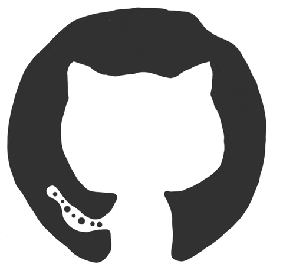

# Hi, I'm Christian Mora

### 💻 Software Engineer · 🤖 Agentic AI Builder
### 🚀 Forward Deployed Engineering

Building useful software. Connecting technology with real-world problems.

---

## 👨‍💻 A little about me

I'm **Christian Mora**, a software developer and data enthusiast. I enjoy building web applications, connecting systems, and turning ideas into useful tools.

My focus brings together **full-stack development**, **agentic AI**, and **forward deployed engineering**: understanding a problem, building a solution, and iterating with the people who use it.

- 🧩 **Build:** frontend experiences, backend services, and integrations.
- 🤖 **Explore:** AI agents and workflows that connect software with everyday work.
- 🎯 **Focus:** practical solutions to real user and business problems.
- 🛠️ **Enjoy:** solving problems, experimenting, and fixing the things I break along the way.

## 🧰 My toolbox

### 🎨 Frontend

  
  
  
  
  
  

### ⚙️ Backend & data

  
  
  
  
  

### 🔧 Development

  
  
  

### 🤖 Current focus

  
  
  
  

## 🚀 What you'll find here

| 💻 Applications | 🔌 Backend & integrations | 🧪 Experiments |
| :--- | :--- | :--- |
| Web projects and product ideas | Services, databases, and connected workflows | Learning projects and technical explorations |

  <a href="https://github.com/ChristianMoraLopez?tab=repositories"><strong>Explore my repositories →</strong></a>

## 🌍 Beyond the code

🇪🇸 **Spanish:** Native &nbsp; · &nbsp; 🇬🇧 **English:** Conversational

I'm always happy to connect with people building useful things.

## ☕ Support my work

If you enjoy my projects, you can [buy me a coffee](https://buymeacoffee.com/christianmora).

---

**Thanks for stopping by!**  
Explore, connect, and leave a ⭐ if a project helps you.

